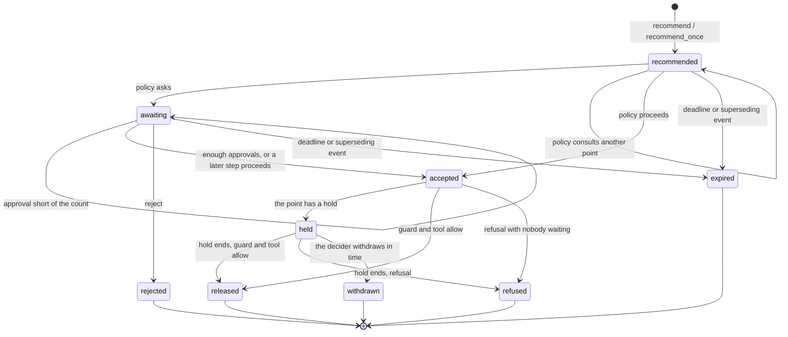

# Decisions

[](https://github.com/gleam-dream/decisions/actions/workflows/ci.yml)
[](https://gleam.run/)

Decisions keeps the record of a **decision point** in Gleam: a place in your
system where a model recommends an output, a policy either proceeds or asks a
person, the person approves, rejects or corrects it, and the final output
reaches a gated tool at most once. Everything that happened is kept as an
append-only record, and that record is the data your system learns from. Gleam
1.18 or later is required.

## When to use Decisions

Use it where an output of a model, a rule or a person must not reach the world
unchecked: refunding a fee, registering a patient from a conversation,
publishing a reply, paying a partner, promoting a build. It fits when you need
to let some cases through automatically and send the rest to a person, to
prove afterwards who decided what on which information, and to raise or lower
the model's autonomy by data instead of a deploy.

Your application owns its transactions, its database pool, its gated tools,
where policy versions are stored, who holds which decision set, and how a
trigger becomes a recommendation. Decisions does not call a model provider,
run an agent, or deliver jobs; it records, decides and releases inside the
transaction you give it.

Do not use it for a workflow of dependent steps (use
[Saga](https://github.com/gleam-dream/saga)), for background jobs (use
[Grind](https://github.com/gleam-dream/grind)), or for an agent loop (use
[Fabric](https://github.com/gleam-dream/fabric)). Those compose with it as
application code.

## Capabilities

- Declare a decision point once: its output type and codec, the verdicts it
  allows, the facts a policy may read, a hold, a validity and the events that
  supersede it.
- Keep every occurrence as append-only entries; its status is a fold of them.
  Read any occurrence as it was known at an earlier time.
- Admit a recommendation at most once per key, even when a trigger is
  delivered twice at the same moment.
- Write policy as versioned data: proceed, ask a decision set, ask several
  different people, escalate as time passes, or consult another decision
  point. A policy that reads an undeclared fact is refused before it is used.
- Show a person a card with the context the model had and the reads it
  received, with every input that changed since flagged; serve it as a typed
  JSON document with its own schema; carry a card across requests with a
  ticket; bind each verdict to the showing it was given on.
- Accept on alternatives such as "two from finance, or one senior", each
  judged on the approvals given so far.
- Release the final output to a gated tool inside the verdict's transaction,
  in a savepoint, at most once, after a guard and an optional release check
  that compares the output with the world; record the evidence both relied on
  and what happened outside the database. A tool that could not tell says so,
  and nothing is recorded as refused.
- Hold what the policy let through by itself (the hold, an undo window carried
  by the policy's `Proceed`), and let a named decision set withdraw it
  meanwhile.
- Expect a trigger in the transaction that receives it, so that a newer event
  supersedes it before the model's late recommendation arrives.
- Tell anyone what really happened with `occurrence.account`, and who decided
  with `occurrence.decided_by`.
- Keep failed model attempts and refused releases on the record.
- Tally agreement, rejections and accuracy per recommender version, page
  through a point's occurrences for export, and replay a candidate model, or
  ask what a candidate policy would have said, with no network.
- Run on PostgreSQL with Grind delivering wake-ups and settlement notices and
  a sweep that gives every pending wake-up and undelivered notice a job, or on a process-safe in-memory
  store under an OTP supervisor whose commits readers see whole.

## Install

The packages are **not yet published on Hex**. Add them from Git:

```toml
[dependencies]
decisions = { git = "https://github.com/gleam-dream/decisions.git", ref = "main" }

# Processes: the in-memory store, the supervised runtime, isolated model calls.
decisions_otp = { git = "https://github.com/gleam-dream/decisions.git", ref = "main", path = "integrations/decisions_otp" }

# PostgreSQL: the storage port, migrations, Grind workers and queue queries.
# pog and pgo must match Grind's ranges exactly.
decisions_postgres = { git = "https://github.com/gleam-dream/decisions.git", ref = "main", path = "integrations/decisions_postgres" }
grind = ">= 0.1.1 and < 0.2.0"
pog = ">= 4.1.0 and < 4.2.0"
pgo = ">= 0.20.0 and < 0.21.0"
```

Commit `gleam.toml` and `manifest.toml` to retain the resolved Git commit.

| Package              | Install it when                                                                                                                                                | Depends on                                                   |
| -------------------- | -------------------------------------------------------------------------------------------------------------------------------------------------------------- | ------------------------------------------------------------ |
| `decisions`          | Always. The pure core: declaration, policy, record, desk, card, learning, the storage port and an in-memory store for tests. Builds for Erlang and JavaScript. | `gleam_stdlib`, `gleam_json`, `gleam_time`, `json_blueprint` |
| `decisions_otp`      | You want the supervised runtime, model calls with a deadline, parallel replay, live hints, or a process-safe store for tests that start processes.             | `decisions`, `gleam_otp`, `gleam_erlang`, `sinal`            |
| `decisions_postgres` | The record must live in PostgreSQL. You own the pool and the Grind runtime.                                                                                    | `decisions`, `pog`, `pgo`, `grind`, `sinal`                  |

## How a decision point works

A **point** is the declaration. A **desk** binds a point to its gated tool, a
function that reads the current policy, and a storage port; it holds no state
and its verbs run in your transaction. Each **occurrence** is one
recommendation about one subject and its record of entries.



`accepted` lasts only inside a verb. The guard, the release check and the tool
each answer `decisions.Stop` when they do not allow a release: `Refuse` for
good, or `Unsure` when they could not tell, such as a lost connection. When a
verdict completes the acceptance and one of them refuses, the verb fails with
`ToolRefused`, your transaction rolls back, and the occurrence still waits;
`record_refusal` keeps the refused verdict on the record in a second
transaction. `Unsure` records nothing as refused: the verb fails with
`ToolUnsure`, and you try again.

Every verb loads and locks the occurrence, reads the store clock, checks, and
appends. A verb that returns an error has written nothing you may keep: roll
back. `decisions.disposition(refusal)` says what to do next by one of four
meanings: deliver again soon for contention (`Transient`); deliver again after a
backoff, counted, for what may never pass (`Retry`); set aside for what needs
an operator (`Poisoned`); or stop, because the occurrence moved on (`Final`).

## Declare a point

The examples share one point: a fee refund at a clinic. The declaration names
the output, its codec and the one fact a policy may read. No threshold lives
here. The gated tool's executor accepts nothing but a released refund.

<!-- prettier-ignore-start -->

<!-- snips: examples/usage/src/decisions_usage/clinic.gleam#refund-point -->
```gleam
import decisions.{type Gated, type Point, Gated}
import decisions/fact
import decisions/memory.{type Memory}
import decisions/vocabulary.{ApproveRejectOrCorrect, Subject, Validator}
import decisions/wire
import gleam/int
import json/blueprint/codec

/// The output of the point: which fee to refund, and how much.
pub type Refund {
  Refund(fee: String, cents: Int)
}

/// The one fact a refund policy may read.
pub fn amount() -> fact.Key(Float) {
  fact.number("amount")
}

/// The declaration: a name, the output's codec (which also carries its
/// JSON Schema), and the facts a policy may read. No threshold lives here.
pub fn refund_point() -> Point(Refund) {
  decisions.point(
    "billing.fee_refund",
    wire.codec({
      use fee <- codec.field("fee", codec.string(), get: fn(r: Refund) { r.fee })
      use cents <- codec.field("cents", codec.int(), get: fn(r: Refund) {
        r.cents
      })
      codec.success(Refund(fee:, cents:))
    }),
  )
  |> decisions.allowing(ApproveRejectOrCorrect)
  |> decisions.fact(amount(), fn(refund: Refund) {
    int.to_float(refund.cents) /. 100.0
  })
}

/// The gated tool. Its executor accepts nothing but a released refund, so
/// no other code path can refund a fee.
pub fn refund_fee() -> Gated(Refund, Memory) {
  Gated(
    name: "refund_fee",
    guard: fn(_tx, _subject) { Ok([]) },
    execute: fn(tx, released) {
      let refund: Refund = decisions.output(released)
      memory.put(tx, "refunded:" <> refund.fee, int.to_string(refund.cents))
      Ok(Nil)
    },
  )
}

```

<!-- prettier-ignore-end -->

## A first point, from recommendation to release

The billing agent recommends refunding Ana's late fee. The policy asks
`finance`; Bia opens the card and approves, and the refund is released once to
the gated tool in her verdict's transaction. The message id is the key, so a
message delivered twice is one occurrence.

<!-- prettier-ignore-start -->

<!-- snips: examples/usage/src/decisions_usage/first_point.gleam#first-point -->
```gleam
import decisions
import decisions/memory.{type Memory}
import decisions/occurrence.{type Occurrence}
import decisions/policy.{AnyoneHolding, Ask, Policy}
import decisions/vocabulary.{
  Agent, Approve, Manifest, Recommendation, Ref, RunAnswer, Trigger,
}
import decisions_usage/clinic.{type Refund, Refund}
import gleam/result

/// Version 1 of the policy: always ask a holder of `finance`.
pub fn always_ask() -> policy.Policy {
  Policy(version: 1, rules: [], otherwise: Ask(AnyoneHolding("finance")))
}

/// The desk binds the point to its gated tool, its policy and a store. It
/// is a plain value; build it wherever it is needed.
pub fn desk() -> decisions.Desk(Refund, Memory) {
  decisions.desk(
    clinic.refund_point(),
    drives: fn(_refund) { clinic.refund_fee() },
    under: fn(_tx) { Ok(always_ask()) },
    over: memory.port(),
  )
}

/// The billing agent recommends refunding Ana's late fee. The trigger's id
/// is the key, so a message delivered twice is one occurrence.
pub fn recommend(
  store: Memory,
) -> Result(Occurrence(Refund), decisions.Refusal) {
  let proposal =
    decisions.proposal(
      trigger: Trigger(kind: "message", id: "m-ana-1"),
      about: clinic.ana,
      context: Manifest(
        refs: [Ref("message", "m-ana-1", "1")],
        renderer: "refund-1",
      ),
      recommending: Recommendation(
        output: Refund(fee: "late-fee-2026-10", cents: 8000),
        by: Agent(kind: "billing", version: "3"),
        explanation: RunAnswer(run: "run-41"),
        signals: [],
        reads: [],
      ),
    )
  memory.transaction(store, decisions.recommend_once(
    desk(),
    _,
    key: "m-ana-1",
    proposal:,
  ))
}

/// Bia opens the card and approves, in one transaction. The refund runs
/// here; if the tool refused, the whole transaction would roll back.
pub fn approve(
  store: Memory,
  id: String,
) -> Result(Occurrence(Refund), decisions.Refusal) {
  memory.transaction(store, fn(tx) {
    use card <- result.try(
      decisions.open(
        desk(),
        tx,
        occurrence: id,
        by: clinic.bia,
        latest: fn(ref) { ref.revision },
      ),
    )
    decisions.decide(desk(), tx, card, Approve)
  })
}

```

<!-- prettier-ignore-end -->

`decisions/memory` is a single-process store for tests and examples. In an
application the same desk runs over `decisions_postgres.port(store)` or
`decisions_otp/store.port()`.

## Policy as data, and the autonomy ladder

A policy is a versioned value: rules over the recommender and declared facts,
and a default outcome. Publishing a version is a write wherever you keep it;
the desk reads it in your transaction and refuses one that fails
`decisions.publishable`. One point climbs from "a person's own act proceeds,
anything else asks" to "small refunds the classifier is sure of proceed, one
in ten sampled for review" without a code change; demoting it is publishing a
stricter version.

<!-- prettier-ignore-start -->

<!-- snips: examples/usage/src/decisions_usage/autonomy_ladder.gleam#autonomy-ladder -->
```gleam
import decisions
import decisions/fact
import decisions/memory.{type Memory}
import decisions/occurrence.{type Occurrence}
import decisions/policy.{
  type Policy, AnyoneHolding, Ask, Never, OwnAct, PerCent, Policy, Proceed, When,
}
import decisions/vocabulary.{
  type Fact, Classifier, Manifest, Receipt, Recommendation, Ref, Trigger,
}
import decisions_usage/clinic.{type Refund, Refund}
import gleam/json
import gleam/option.{None, Some}
import gleam/result
import gleam/time/duration

/// The classifier's confidence, reported beside its output.
pub fn confidence() -> fact.Key(Float) {
  fact.number("confidence")
}

/// The classifier's confidence as a signal.
pub fn confidence_signal(value: Float) -> #(String, Fact) {
  fact.set(confidence(), value)
}

/// The point declares the signal, so a policy may read it.
pub fn point() -> decisions.Point(Refund) {
  clinic.refund_point() |> decisions.signal(confidence())
}

/// Rung 1: a person's own act proceeds; anything else asks finance.
pub fn assisted() -> Policy {
  Policy(
    version: 1,
    rules: [When(OwnAct, Proceed(Never, None))],
    otherwise: Ask(AnyoneHolding("finance")),
  )
}

/// Rung 2: small refunds the classifier is sure of proceed, and one in ten
/// of those is sampled for a review after the fact.
pub fn confident() -> Policy {
  Policy(
    version: 2,
    rules: [
      When(OwnAct, Proceed(Never, None)),
      When(
        policy.All([
          policy.at_least(confidence(), 0.95),
          policy.below(clinic.amount(), 100.0),
        ]),
        Proceed(PerCent(10), None),
      ),
    ],
    otherwise: Ask(AnyoneHolding("finance")),
  )
}

/// Rung 3: the same refunds proceed with a thirty-minute undo window
/// instead of a sample: each is held, and released when the window ends
/// unless finance withdraws it first.
pub fn undoable() -> Policy {
  Policy(
    version: 3,
    rules: [
      When(OwnAct, Proceed(Never, None)),
      When(
        policy.All([
          policy.at_least(confidence(), 0.95),
          policy.below(clinic.amount(), 100.0),
        ]),
        Proceed(Never, Some(duration.minutes(30))),
      ),
    ],
    otherwise: Ask(AnyoneHolding("finance")),
  )
}

/// Publishing a version is a write, refused when the policy reads a fact
/// the point never declares.
pub fn publish(
  store: Memory,
  version: Policy,
) -> Result(Nil, List(policy.Fault)) {
  use Nil <- result.map(decisions.publishable(point(), version))
  memory.put(
    store,
    "policy:billing.fee_refund",
    json.to_string(policy.to_json(version)),
  )
}

/// The desk reads whichever version is published, in the caller's
/// transaction.
pub fn desk() -> decisions.Desk(Refund, Memory) {
  decisions.desk(
    point(),
    drives: fn(_) { clinic.refund_fee() },
    under: fn(tx) {
      use text <- result.try(
        memory.get(tx, "policy:billing.fee_refund")
        |> result.replace_error("no policy is published"),
      )
      json.parse(text, policy.decoder())
      |> result.replace_error("the stored policy does not decode")
    },
    over: memory.port(),
  )
}

/// The one code path that files a refund. It knows nothing of the policy.
pub fn arrive(
  store: Memory,
  fee: String,
  cents: Int,
  sure: Float,
) -> Result(Occurrence(Refund), decisions.Refusal) {
  memory.transaction(store, decisions.recommend_once(
    desk(),
    _,
    key: fee,
    proposal: decisions.proposal(
      trigger: Trigger(kind: "statement_line", id: fee),
      about: clinic.clinica_x,
      context: Manifest(
        refs: [Ref("statement_line", fee, "1")],
        renderer: "refund-1",
      ),
      recommending: Recommendation(
        output: Refund(fee:, cents:),
        by: Classifier(name: "refund-classifier", version: "v5"),
        explanation: Receipt(Ref("classifier", fee, "1")),
        signals: [fact.set(confidence(), sure)],
        reads: [],
      ),
    ),
  ))
}

```

<!-- prettier-ignore-end -->

A condition over an absent fact never matches, so what is unknown never
proceeds. Every `policy_applied` entry records the version that gave it.

## Cards across requests

A page or another system keeps a card's `Ticket` (the occurrence and the
showing) and nothing else, and gets the same card back with `resume`. A ticket
shown to someone else is refused with `NeverShown`; one shown before another
validator corrected the output is refused with `OutputChanged`.

<!-- prettier-ignore-start -->

<!-- snips: examples/usage/src/decisions_usage/ticket.gleam#ticket -->
```gleam
import decisions.{type Ticket}
import decisions/memory.{type Memory}
import decisions/occurrence.{type Occurrence}
import decisions/vocabulary.{type Validator, Approve}
import decisions_usage/clinic.{type Refund}
import decisions_usage/first_point
import gleam/result

/// First request: show the card, and give the page its ticket.
pub fn show(
  store: Memory,
  id: String,
  to validator: Validator,
) -> Result(Ticket, decisions.Refusal) {
  memory.transaction(store, fn(tx) {
    decisions.open(
      first_point.desk(),
      tx,
      occurrence: id,
      by: validator,
      latest: fn(ref) { ref.revision },
    )
    |> result.map(decisions.ticket)
  })
}

/// A later request: the page sends the ticket back with the verdict.
/// Resuming records nothing; a ticket that names no showing to this
/// validator is refused.
pub fn approve(
  store: Memory,
  ticket: Ticket,
  by validator: Validator,
) -> Result(Occurrence(Refund), decisions.Refusal) {
  memory.transaction(store, fn(tx) {
    use card <- result.try(decisions.resume(
      first_point.desk(),
      tx,
      ticket,
      by: validator,
    ))
    decisions.decide(first_point.desk(), tx, card, Approve)
  })
}

```

<!-- prettier-ignore-end -->

## Four eyes and escalation

A large refund needs two different approvers, neither of them the person who
asked. Unanswered for four hours, managers may give the second approval too;
after a day the occurrence expires. All of it is policy data, applied by the
desk's wake-ups. A queue leaves a card out for whoever the head says may not
decide it.

<!-- prettier-ignore-start -->

<!-- snips: examples/usage/src/decisions_usage/four_eyes.gleam#four-eyes -->
```gleam
import decisions
import decisions/memory.{type Memory}
import decisions/occurrence.{type Occurrence}
import decisions/policy.{
  AnyoneHolding, Ask, Either, Policy, Several, SomeoneElseHolding, When,
}
import decisions/vocabulary.{
  type Validator, Agent, Approve, Manifest, Recommendation, RunAnswer, Trigger,
  Validator,
}
import decisions_usage/clinic.{type Refund, Refund}
import gleam/int
import gleam/list
import gleam/option.{type Option, Some}
import gleam/result
import gleam/time/duration
import gleam/time/timestamp.{type Timestamp}

/// Rui manages the clinic's billing; he holds no finance set.
pub const rui = Validator(subject: "rui", holds: ["managers"])

pub fn policy() -> policy.Policy {
  let large = policy.at_least(clinic.amount(), 10_000.0)
  Policy(
    version: 1,
    rules: [
      When(
        policy.All([large, policy.waited(240)]),
        Ask(Several(
          2,
          Either([SomeoneElseHolding("finance"), AnyoneHolding("managers")]),
        )),
      ),
      When(large, Ask(Several(2, SomeoneElseHolding("finance")))),
    ],
    otherwise: Ask(SomeoneElseHolding("finance")),
  )
}

pub fn desk() -> decisions.Desk(Refund, Memory) {
  decisions.desk(
    clinic.refund_point() |> decisions.valid_for(duration.hours(24)),
    drives: fn(_) { clinic.refund_fee() },
    under: fn(_) { Ok(policy()) },
    over: memory.port(),
  )
}

/// Felipe asks for a large refund for Clínica X.
pub fn ask(store: Memory) -> Result(Occurrence(Refund), decisions.Refusal) {
  memory.transaction(store, decisions.recommend_once(
    desk(),
    _,
    key: "refund-cx-1",
    proposal: decisions.proposal(
      trigger: Trigger(kind: "request", id: "refund-cx-1"),
      about: clinic.clinica_x,
      context: Manifest(refs: [], renderer: "refund-1"),
      recommending: Recommendation(
        output: Refund(fee: "annual-fee-2026", cents: 1_200_000),
        by: Agent(kind: "billing", version: "3"),
        explanation: RunAnswer(run: "run-77"),
        signals: [],
        reads: [],
      ),
    )
      |> decisions.asked_by("felipe"),
  ))
}

pub fn approve(
  store: Memory,
  id: String,
  by validator: Validator,
) -> Result(Occurrence(Refund), decisions.Refusal) {
  memory.transaction(store, fn(tx) {
    use card <- result.try(
      decisions.open(desk(), tx, occurrence: id, by: validator, latest: fn(ref) {
        ref.revision
      }),
    )
    decisions.decide(desk(), tx, card, Approve)
  })
}

/// The job queue's handler: deliver every wake-up that is due. One that
/// arrived early names the time to come back, and is snoozed until then.
pub fn deliver_due(store: Memory) -> List(Option(Timestamp)) {
  let #(_point, wake) = decisions.waker(desk())
  memory.take_due(store)
  |> list.filter_map(fn(due) {
    let delivered = memory.transaction(store, wake(_, due.occurrence))
    case delivered {
      Ok(Some(until)) -> memory.snooze(store, due, until)
      _ -> Nil
    }
    delivered
  })
}

```

<!-- prettier-ignore-end -->

## Two from finance, or one senior

An eligibility with alternatives is judged per alternative on the approvals
given so far. A large refund is accepted on two approvals from finance, or on
one from the head of finance, never on one finance approval. Each verdict
records the decision sets its validator held.

<!-- prettier-ignore-start -->

<!-- snips: examples/usage/src/decisions_usage/two_or_one_senior.gleam#either-several -->
```gleam
import decisions
import decisions/memory.{type Memory}
import decisions/occurrence
import decisions/policy.{AnyoneHolding, Ask, Either, Policy, Several}
import decisions/vocabulary.{
  type Validator, Agent, Approve, Manifest, Recommendation, RunAnswer, Trigger,
  Validator,
}
import decisions_usage/clinic.{type Refund, Refund}
import gleam/result

pub const head_of_finance = Validator(subject: "lia", holds: ["head_of_finance"])

pub fn desk() -> decisions.Desk(Refund, Memory) {
  decisions.desk(
    clinic.refund_point(),
    drives: fn(_) { clinic.refund_fee() },
    under: fn(_) {
      Ok(Policy(
        version: 1,
        rules: [],
        otherwise: Ask(
          Either([
            Several(2, AnyoneHolding("finance")),
            AnyoneHolding("head_of_finance"),
          ]),
        ),
      ))
    },
    over: memory.port(),
  )
}

pub fn approve(store: Memory, id: String, by validator: Validator) -> String {
  memory.transaction(store, fn(tx) {
    use card <- result.try(
      decisions.open(desk(), tx, occurrence: id, by: validator, latest: fn(ref) {
        ref.revision
      }),
    )
    decisions.decide(desk(), tx, card, Approve)
  })
  |> result.map(fn(known) { occurrence.status_name(known.status) })
  |> result.unwrap("refused")
}

```

<!-- prettier-ignore-end -->

## An undo window on what the policy lets through

The window is part of the policy's outcome: `Proceed(sample:, hold:)` holds
only what the policy accepted by itself, and what a person approved is released
at once. A new policy version changes the window for new acceptances, not for
an occurrence already held. Holders of the set named with `withdrawn_by` may
take a held output back until the hold ends by the store clock, and a newer
event declared with `superseded_by` ends a held occurrence with nothing
released.

<!-- prettier-ignore-start -->

<!-- snips: examples/usage/src/decisions_usage/undo_window.gleam#undo-window -->
```gleam
import decisions
import decisions/memory.{type Memory}
import decisions/occurrence
import decisions/policy.{AnyoneHolding, Ask, Never, Policy, Proceed, When}
import decisions/vocabulary.{
  Classifier, Manifest, Receipt, Recommendation, Ref, Trigger,
}
import decisions_usage/autonomy_ladder
import decisions_usage/clinic.{type Refund, Refund}
import gleam/option.{Some}
import gleam/time/duration

pub fn desk() -> decisions.Desk(Refund, Memory) {
  decisions.desk(
    autonomy_ladder.point() |> decisions.withdrawn_by("finance"),
    drives: fn(_) { clinic.refund_fee() },
    under: fn(_) {
      Ok(Policy(
        version: 1,
        rules: [
          When(
            policy.at_least(autonomy_ladder.confidence(), 0.95),
            // Proceed, with a thirty-minute undo window.
            Proceed(Never, Some(duration.minutes(30))),
          ),
        ],
        otherwise: Ask(AnyoneHolding("finance")),
      ))
    },
    over: memory.port(),
  )
}

/// Bia takes back a refund the policy let proceed, within its window.
pub fn take_back(
  store: Memory,
  id: String,
) -> Result(occurrence.Occurrence(Refund), decisions.Refusal) {
  memory.transaction(store, decisions.withdraw_as(
    desk(),
    _,
    occurrence: id,
    by: clinic.bia,
  ))
}

```

<!-- prettier-ignore-end -->

## Admit a trigger before the model runs

A model can take a while, and a newer event about the same subject can arrive
meanwhile. In the transaction that receives a trigger, call
`decisions.happened` with the point's superseding event and then
`decisions.expect` with the trigger's key, in that order. From then on a later
`happened` supersedes the expected record before it begins, and the late
recommendation is refused. `happened` first takes a lock per point and subject
(the subject lock), so two triggers about one subject admitted at the same
moment are handled one after the other and the second supersedes the first's
expectation. In the other order two admissions can deadlock; the store refuses
one with `Contended`, and it is delivered again.

| The trigger was                            | Then                                 | Result                                                     |
| ------------------------------------------ | ------------------------------------ | ---------------------------------------------------------- |
| Expected, and nothing newer happened       | `recommend_once`                     | The occurrence begins as usual                             |
| Expected, and a newer event happened first | `recommend_once` or `record_failure` | Refused with `SupersededBefore(event)`; nothing is written |
| Never expected                             | `recommend_once` after `happened`    | The occurrence begins; nothing supersedes it               |

In the example below a statement line is expected when it arrives, and a
corrected statement for the same company later supersedes it. A record that
has been expected and not yet recommended has the head status `pending`; `decisions_postgres/queue.pending` lists them, oldest first.

<!-- prettier-ignore-start -->

<!-- snips: examples/usage/src/decisions_usage/expect_then_recommend.gleam#expect-then-recommend -->
```gleam
import decisions
import decisions/memory.{type Memory}
import decisions/policy.{AnyoneHolding, Ask, Policy}
import decisions/vocabulary.{
  Classifier, Manifest, Receipt, Recommendation, Ref, Trigger,
}
import decisions_usage/clinic.{type Refund, Refund}
import gleam/result

pub fn desk() -> decisions.Desk(Refund, Memory) {
  decisions.desk(
    clinic.refund_point() |> decisions.superseded_by("statement_corrected"),
    drives: fn(_) { clinic.refund_fee() },
    under: fn(_) { Ok(Policy(1, [], Ask(AnyoneHolding("finance")))) },
    over: memory.port(),
  )
}

/// The transaction that receives a statement line: it expects the
/// recommendation before the classifier's job is queued.
pub fn receive(store: Memory, fee: String) -> Result(Nil, decisions.Refusal) {
  memory.transaction(store, decisions.expect(
    desk(),
    _,
    key: "refund:" <> fee,
    trigger: Trigger(kind: "statement_line", id: fee),
    about: clinic.clinica_x,
  ))
}

/// The transaction that receives a corrected statement.
pub fn correct(store: Memory) -> Result(List(String), decisions.Refusal) {
  memory.transaction(store, decisions.happened(
    desk(),
    _,
    "statement_corrected",
    about: clinic.clinica_x,
  ))
  |> result.map(fn(superseded) { superseded.not_begun })
}

/// The classifier's job commits its recommendation.
pub fn recommend(
  store: Memory,
  fee: String,
) -> Result(String, decisions.Refusal) {
  memory.transaction(store, decisions.recommend_once(
    desk(),
    _,
    key: "refund:" <> fee,
    proposal: decisions.proposal(
      trigger: Trigger(kind: "statement_line", id: fee),
      about: clinic.clinica_x,
      context: Manifest(refs: [], renderer: "refund-1"),
      recommending: Recommendation(
        output: Refund(fee:, cents: 4000),
        by: Classifier(name: "refund-classifier", version: "v5"),
        explanation: Receipt(Ref("classifier", fee, "1")),
        signals: [],
        reads: [],
      ),
    ),
  ))
  |> result.map(fn(recorded) { recorded.id })
}

```

<!-- prettier-ignore-end -->

## A deadline of the occurrence's own

A point's `valid_for` counts from the recommendation. When an occurrence must
end at an instant the application knows when it admits the trigger, such as
the close of a customer's 24-hour service window, give that instant to the
occurrence itself: `decisions.expect_until(.., valid_until:)` on the
expectation, or `decisions.valid_until(proposal, at:)` on the proposal. The
recommendation carries the earliest of the point's validity, the
expectation's deadline and the proposal's; a deadline never moves later. One
wake-up expires the occurrence at it, with cause `DeadlinePassed`, decided by
the store clock whether or not the wake-up was delivered on time.

| At or after the deadline                   | Result                                                          |
| ------------------------------------------ | --------------------------------------------------------------- |
| A verdict, a showing, a note               | Refused with `NotAwaiting`, as for a point's validity           |
| The wake-up, nothing recommended yet       | The record expires with `DeadlinePassed`; one settlement notice |
| `record_failure`, `expect`, `expect_until` | Refused with `DeadlinePassedBefore(deadline)`; nothing written  |
| `recommend_once`                           | Recorded and expired at once; no policy runs, nothing is shown  |
| A key expected with `expect` alone         | No deadline until it is recommended, as before                  |

The record not begun is due at its deadline: `decisions_postgres/queue.pending`
reports it in `due`.

<!-- prettier-ignore-start -->

<!-- snips: examples/usage/src/decisions_usage/deadline_per_occurrence.gleam#deadline-per-occurrence -->
```gleam
import decisions
import decisions/memory.{type Memory}
import decisions/occurrence
import decisions/policy.{AnyoneHolding, Ask, Policy}
import decisions/vocabulary.{
  Agent, Manifest, Recommendation, RuleFired, Subject, Trigger,
}
import decisions/wire
import gleam/option.{Some}
import gleam/result
import gleam/time/duration
import gleam/time/timestamp.{type Timestamp}

pub fn desk() -> decisions.Desk(String, Memory) {
  decisions.desk(
    // No validity of its own: each draft carries its window.
    decisions.point("reply.draft", wire.text()),
    drives: fn(_) {
      decisions.Gated(
        name: "send",
        guard: fn(_, _) { Ok([]) },
        execute: fn(_, _) { Ok(Nil) },
      )
    },
    under: fn(_) { Ok(Policy(1, [], Ask(AnyoneHolding("support")))) },
    over: memory.port(),
  )
}

/// The transaction that stores the customer's message expects the draft,
/// due when the service window closes.
pub fn receive(
  store: Memory,
  message: String,
  written_at: Timestamp,
) -> Result(Nil, decisions.Refusal) {
  memory.transaction(store, decisions.expect_until(
    desk(),
    _,
    key: "reply:" <> message,
    trigger: Trigger(kind: "message", id: message),
    about: Subject("party", "ana"),
    valid_until: timestamp.add(written_at, duration.hours(24)),
  ))
}

/// The model's draft keeps the deadline the expectation carries.
pub fn draft(
  store: Memory,
  message: String,
  text: String,
) -> Result(occurrence.Occurrence(String), decisions.Refusal) {
  memory.transaction(store, decisions.recommend_once(
    desk(),
    _,
    key: "reply:" <> message,
    proposal: decisions.proposal(
      trigger: Trigger(kind: "message", id: message),
      about: Subject("party", "ana"),
      context: Manifest(refs: [], renderer: "reply-1"),
      recommending: Recommendation(
        output: text,
        by: Agent(kind: "reply", version: "1"),
        explanation: RuleFired("draft"),
        signals: [],
        reads: [],
      ),
    ),
  ))
}

```

<!-- prettier-ignore-end -->

## An effect outside the database

The gated tool never calls the provider. It writes an instruction beside the
release, in the release's transaction; a worker performs it under the
release key; `report` records whether it was performed, not performed, or is
uncertain. An uncertain effect is settled by looking it up by that key, never
by retrying blindly.

<!-- prettier-ignore-start -->

<!-- snips: examples/usage/src/decisions_usage/provider_effect.gleam#provider-effect -->
```gleam
import decisions.{type Gated, Gated}
import decisions/memory.{type Memory}
import decisions/occurrence
import decisions/vocabulary.{
  type Effect, Agent, Approve, Manifest, NotPerformed, Performed, Recommendation,
  Ref, RunAnswer, Trigger, Uncertain,
}
import decisions_usage/clinic.{type Refund}
import decisions_usage/first_point
import gleam/int
import gleam/option
import gleam/result

/// The tool writes the instruction; the release's key is the idempotency
/// key the provider will be sent.
pub fn instruct() -> Gated(Refund, Memory) {
  Gated(
    name: "refund_at_provider",
    guard: fn(_, _) { Ok([]) },
    execute: fn(tx, released) {
      let refund: Refund = decisions.output(released)
      memory.put(
        tx,
        "instruction:" <> decisions.key(released),
        decisions.occurrence_of(released) <> "|" <> int.to_string(refund.cents),
      )
      Ok(Nil)
    },
  )
}

pub fn desk() -> decisions.Desk(Refund, Memory) {
  decisions.desk(
    clinic.refund_point(),
    drives: fn(_) { instruct() },
    under: fn(_) { Ok(first_point.always_ask()) },
    over: memory.port(),
  )
}

/// What the provider said, as the worker saw it.
pub type Answer {
  Paid(receipt: String)
  Declined(reason: String)
  NoAnswer
}

/// The worker, after calling the provider under the release's key: it
/// reports what became of the release. An unknown outcome is recorded as
/// uncertain; a later lookup by the same key settles it with another
/// report.
pub fn record(
  store: Memory,
  id: String,
  key: String,
  answer: Answer,
) -> Result(Effect, decisions.Refusal) {
  let effect = case answer {
    Paid(receipt:) -> Performed(Ref("provider.receipt", key, receipt))
    Declined(reason:) -> NotPerformed(reason)
    NoAnswer -> Uncertain("the provider did not answer within 10 s")
  }
  memory.transaction(store, decisions.report(desk(), _, occurrence: id, effect:))
  |> result.replace(effect)
}

```

<!-- prettier-ignore-end -->

## Show a person the same context the model had

One reader function builds the model's typed context and the card's. The
model's reads are captured as evidence before it sees them, so after the world
changes the card still shows what the model had and flags what changed.

<!-- prettier-ignore-start -->

<!-- snips: examples/usage/src/decisions_usage/same_context.gleam#same-context -->
```gleam
import decisions
import decisions/memory.{type Memory}
import decisions/model.{type Reader, type Sources, Sources}
import decisions/occurrence
import decisions/view.{type View}
import decisions/vocabulary.{
  type Manifest, type Ref, Manifest, ModelCall, Receipt, Recommendation, Ref,
  Trigger,
}
import decisions_usage/clinic.{type Refund, Refund}
import decisions_usage/first_point
import gleam/result

/// What the billing model needs to decide a refund.
pub type Dossier {
  Dossier(message: String, balance: String)
}

/// The one function that reads the context: the model and the card both
/// get their `Dossier` from it.
pub fn read_dossier() -> Reader(Dossier) {
  fn(context: Manifest, sources: Sources) {
    use message <- result.try(case context.refs {
      [ref, ..] -> sources.resolve(ref)
      [] -> Error(model.Declined("the context names no message"))
    })
    use balance <- result.try(sources.read("balance", "ana"))
    Ok(Dossier(message:, balance: balance.body))
  }
}

pub fn billing_model() -> model.Model(Refund) {
  model.over(read_dossier(), fn(dossier: Dossier) {
    let cents = case dossier.balance {
      "overdue 80.00" -> 8000
      _ -> 0
    }
    Ok(
      Recommendation(
        output: Refund(fee: "late-fee-2026-10", cents:),
        by: ModelCall(configuration: "billing-llm", version: "2026-11"),
        explanation: Receipt(Ref("llm_call", "call-7", "1")),
        signals: [],
        reads: [],
      ),
    )
  })
}

/// Sources in production: a context reference resolves from the store, and
/// a read is captured as evidence before the model sees it.
pub fn live(store: Memory, balance: fn() -> Result(String, String)) -> Sources {
  Sources(
    resolve: fn(ref: Ref) {
      memory.get(store, "message:" <> ref.id)
      |> result.replace_error(model.ReadFailed(
        ref.kind,
        ref.id,
        "no such message",
      ))
    },
    read: fn(name, argument) {
      model.capture(
        memory.evidence(),
        store,
        source: name,
        request: argument,
        fetch: balance,
      )
      |> result.map_error(model.ReadFailed(name, argument, _))
    },
  )
}

/// What the record holds, by reference: the content as it was read.
pub fn recorded(store: Memory) -> fn(Ref) -> Result(String, model.Failure) {
  fn(ref: Ref) {
    case ref.kind {
      "message" ->
        memory.get(store, "message:" <> ref.id) |> result.replace_error(Nil)
      _ -> memory.evidence().get(store, ref) |> result.replace_error(Nil)
    }
    |> result.replace_error(model.NotRecorded(ref.kind, ref.id))
  }
}

/// Felipe's card: the same `Dossier` the model had, and the document a
/// page renders, with each input as read and what changed since.
pub fn card(
  store: Memory,
  id: String,
  latest: fn(Ref) -> String,
) -> Result(#(Dossier, View(Refund)), decisions.Refusal) {
  memory.transaction(store, fn(tx) {
    use card <- result.try(decisions.open(
      first_point.desk(),
      tx,
      occurrence: id,
      by: clinic.felipe,
      latest:,
    ))
    use dossier <- result.try(
      view.context(
        decisions.shown(card),
        with: read_dossier(),
        content: recorded(store),
      )
      |> result.map_error(fn(failure) {
        decisions.Unreadable(model.describe(failure))
      }),
    )
    Ok(#(dossier, view.of(card, content: recorded(store))))
  })
}

```

<!-- prettier-ignore-end -->

## The card as a typed document

The card crosses a process boundary as a `decision-card.v1` JSON document:
exactly the encoding of `view.codec`, which carries the document's JSON Schema
and the output's. A client with none of the point's code can show it and send a
verdict back; a client with the same codec decodes it typed.

<!-- prettier-ignore-start -->

<!-- snips: examples/usage/src/decisions_usage/card_document.gleam#card-document -->
```gleam
import decisions
import decisions/memory
import decisions/view.{type View}
import decisions_usage/clinic.{type Refund}
import decisions_usage/first_point
import gleam/result
import json/blueprint/codec

/// The schema a server publishes for its cards, as JSON text.
pub fn card_schema() -> Result(String, codec.SchemaError) {
  codec.schema_json(view.codec(clinic.refund_point() |> decisions.codec))
}

/// The server's side: the card as JSON text.
pub fn serve(card: decisions.Card(Refund)) -> Result(String, String) {
  view.of(card, content: fn(ref) { Ok("message " <> ref.id) })
  |> codec.encode_json(view.codec(decisions.codec(clinic.refund_point())), _)
  |> result.map_error(codec.describe_encode_error)
}

/// A client's side: the same document, decoded typed.
pub fn read(text: String) -> Result(View(Refund), String) {
  codec.decode_json(view.codec(decisions.codec(clinic.refund_point())), text)
  |> result.map_error(codec.describe_decode_error)
}

```

<!-- prettier-ignore-end -->

## Learn and replay

Agreement and accuracy are folds over records, per recommender version. An
occurrence is judged when people let an output through; an approval lets
through the output that stands, a correction its own output, and a rejection
nothing. Each recorded occurrence exports as a self-contained example, and a
candidate model runs on the examples alone, with no network and no gated
tool.

<!-- prettier-ignore-start -->

<!-- snips: examples/usage/src/decisions_usage/replay.gleam#replay -->
```gleam
import decisions
import decisions/learning.{type Replay, Archive}
import decisions/memory.{type Memory}
import decisions/model.{type Model}
import decisions/occurrence.{type Occurrence}
import decisions/vocabulary.{
  type Manifest, type Ref, Approve, Correct, Manifest, Reason, Recommendation,
  Ref, RuleFired, Rules, Trigger,
}
import decisions_usage/clinic.{type Refund, Refund}
import decisions_usage/first_point
import gleam/int
import gleam/list
import gleam/option.{None}
import gleam/result
import gleam/time/timestamp

/// A rule that refunds the whole fee whose statement line it reads.
pub fn whole_fee(version: String) -> Model(Refund) {
  model.new(fn(context: Manifest, sources: model.Sources) {
    use line <- result.try(
      list.first(context.refs)
      |> result.replace_error(model.Declined("no statement line")),
    )
    use text <- result.try(sources.resolve(line))
    let cents = int.parse(text) |> result.unwrap(0)
    let cents = case version {
      // Version 2 refunds half of anything above R$100.
      "2" if cents > 10_000 -> cents / 2
      _ -> cents
    }
    Ok(
      Recommendation(
        output: Refund(fee: line.id, cents:),
        by: Rules(name: "whole-fee", version:),
        explanation: RuleFired("refund-the-line"),
        signals: [],
        reads: [],
      ),
    )
  })
}

/// Export what was decided, then score a candidate on it.
pub fn score(
  recorded: List(Occurrence(Refund)),
  candidate: Model(Refund),
  lines: model.Resolver,
) -> Result(Replay, learning.ExportError) {
  let archive =
    Archive(
      render: fn(_) { Ok("refund-1") },
      reads: fn(_) { [] },
      content: lines,
    )
  let now = timestamp.from_unix_seconds(4_000_000_000)
  use examples <- result.map(
    list.try_map(recorded, learning.example(_, as_of: now, from: archive)),
  )
  learning.replay(examples, candidate, same: fn(a, b) { a == b })
}

```

<!-- prettier-ignore-end -->

`decisions_otp/replay` spreads a replay over every core with the same tally.

## Run it on the BEAM

`decisions_otp/runtime` is a supervisor you add to your tree. It delivers what
the record says is owed and keeps nothing a kill could lose:

| Process     | Owns                                                | Killed: what is lost                                                                          |
| ----------- | --------------------------------------------------- | --------------------------------------------------------------------------------------------- |
| Sweeper     | Delivering due wake-ups                             | Nothing: a wake-up leaves the backlog in the transaction that acts on it                      |
| Dispatcher  | Delivering each settlement to its point's follower  | Nothing: a notice is marked delivered in the follower's transaction                           |
| Workers     | Turning one trigger at a time into a recommendation | Nothing: the claim dies with the worker and `recommend_once` makes a second delivery harmless |
| Store owner | Every row of the in-memory store                    | Everything: a restarted store is empty, so the runtime restarts with it                       |

The store goes first under a `RestForOne` supervisor and the runtime after it,
configured at every start from the store's current handle:

<!-- prettier-ignore-start -->

<!-- snips: integrations/decisions_otp/test/wiring_example.gleam#otp-runtime -->
```gleam
/// The refund point, its gated tool, and what follows a settlement.
pub fn refund_desk() -> decisions.Desk(String, store.Tx) {
  decisions.desk(
    decisions.point("billing.fee_refund", wire.text()),
    drives: fn(_) {
      decisions.Gated(
        name: "refund",
        guard: fn(_, _) { Ok([]) },
        execute: fn(tx, released) {
          // The gated tool's write commits with the verdict that released it.
          store.add(tx, "refunds", decisions.output(released))
          Ok(Nil)
        },
      )
    },
    under: fn(_) {
      Ok(Policy(version: 1, rules: [], otherwise: Ask(AnyoneHolding("finance"))))
    },
    over: store.port(),
  )
}

/// What follows a settled refund: here, a row in the same transaction.
pub fn tell_the_customer(
  tx: store.Tx,
  refund: occurrence.Occurrence(String),
) -> Result(Nil, decisions.HandlerFailure) {
  store.add(tx, "outbox", "your refund " <> refund.id <> " is settled")
  Ok(Nil)
}

/// The application's tree: the store first, then the runtime that
/// delivers its wake-ups, settlements and triggers. `RestForOne`: if the
/// store's owner exits (losing everything), the runtime restarts with it
/// and takes a fresh handle.
pub fn start(
  name: store.Name,
  control: runtime.Control,
) -> Result(actor.Started(supervisor.Supervisor), actor.StartError) {
  supervisor.new(supervisor.RestForOne)
  |> supervisor.add(store.supervised(store.defaults(), named: name))
  |> supervisor.add(
    // Configured at each start, from the store's current handle.
    runtime.supervised_from(fn() {
      use s <- result.map(
        store.named(name) |> result.replace_error("the store is not running"),
      )
      runtime.Config(
        ..runtime.config(
          store.backlog(s),
          points: [runtime.point(refund_desk(), settled: tell_the_customer)],
          work: fn(_trigger) { Ok(Nil) },
        ),
        name: "refunds",
        control: Some(control),
      )
    }),
  )
  |> supervisor.start
}
```

<!-- prettier-ignore-end -->

A follower returns `decisions.HandlerFailure`, and `decisions.handling` turns it
into one of four answers both runtimes act on: `Redeliver` contention without
counting it; `Backoff` after your own failure, a raise, a conflict, an
unreadable policy, a failed consult or a tool that was unsure, and count it;
`SetAside` what needs an operator; `Drop` a job whose occurrence moved on.
After 20 counted failures the job is set aside. A crashed runtime transaction
is delivered again uncounted; a handler that raises is counted. The store's
commits are seen whole by every reader, and `restart` keeps every
acknowledged commit. A `Control`
pauses and resumes delivery. `decisions_otp/isolated` runs a model in a process
of its own with a deadline it cannot ignore, records a failed attempt, and with
`recommend_when` checks a precondition inside the recommending transaction. The
in-memory store loses everything when its owner stops; use it for tests and
for deployments that accept that. See the
[package README](integrations/decisions_otp/README.md).

## Run it on PostgreSQL

You own the pool, Grind and the migration. In this order: run `migrate`; build
the store over a Grind handle by name and the desks over the store's port; put
the workers built from the desks on Grind's configuration; start Grind in your
supervision tree; then run `sweep`, which gives every pending wake-up and
undelivered notice a job.

<!-- prettier-ignore-start -->

<!-- snips: integrations/decisions_postgres/test/wiring/postgres_wiring.gleam#postgres-wiring -->
```gleam
import decisions_postgres

/// The running pieces an application keeps.
pub type Wired {
  Wired(
    db: pog.Connection,
    refunds: decisions.Desk(String, pog.Connection),
    store: decisions_postgres.Store,
  )
}

/// At deploy time, with a role that may own DDL: bring the tables up to
/// date before any worker polls. Here on a pool of its own, closed after.
pub fn migrate_at_deploy(pool: pog.Config) -> Result(Nil, String) {
  let pool = pog.Config(..pool, pool_name: process.new_name("migrate"))
  use started <- result.try(
    pog.start(pool) |> result.replace_error("no database to migrate"),
  )
  let migrated =
    decisions_postgres.migrate(started.data)
    |> result.map_error(decisions_postgres.describe_migrate_error)
  process.unlink(started.pid)
  process.kill(started.pid)
  migrated
}

/// Start-up, after the migration: (1) a Grind handle by name, valid before
/// Grind runs; (2) the store over it and the desks over the store's port;
/// (3) Grind's configuration with the wake and settlement workers, which
/// must be registered before Grind starts; (4) Grind in the application's
/// supervision tree; (5) `sweep`, so every pending wake-up and notice has
/// a job.
pub fn start(pool: pog.Config) -> Result(Wired, String) {
  let name = process.new_name("app_grind")
  let jobs = grind.named(name)
  let store =
    decisions_postgres.new(jobs)
    |> decisions_postgres.with_name("billing")
    |> decisions_postgres.following("billing.fee_refund")
  let refunds =
    decisions.desk(
      decisions.point("billing.fee_refund", wire.text()),
      drives: refund_tool,
      under: fn(_) {
        Ok(Policy(
          version: 1,
          rules: [],
          otherwise: Ask(AnyoneHolding("finance")),
        ))
      },
      over: decisions_postgres.port(store),
    )
  let config =
    grind.new(pool)
    |> grind.with_worker(
      decisions_postgres.wake_worker(store, [decisions.waker(refunds)]),
    )
    |> grind.with_worker(
      decisions_postgres.settlement_worker(store, [
        #("billing.fee_refund", notify_customer),
      ]),
    )
    |> grind.with_startup_migration
  use _ <- result.try(
    supervisor.new(supervisor.OneForOne)
    |> supervisor.add(grind.supervised(config, name))
    |> supervisor.start
    |> result.replace_error("the supervision tree did not start"),
  )
  let db = grind.connection(jobs)
  use _ <- result.try(
    decisions_postgres.sweep(store, db)
    |> result.replace_error("the sweep could not read the store"),
  )
  Ok(Wired(db:, refunds:, store:))
}

```

<!-- prettier-ignore-end -->

Run each verb in your transaction at `READ COMMITTED`; the port refuses another
isolation level with `Conflict`, because the subject lock relies on each
statement seeing what the lock's previous holder committed. Or run it through
`decisions_postgres.transaction`, `transaction_with` (a body that also fails
with your own error) and `decide`. The adapter's guarantees rest on the
database: an advisory lock on an id that does not exist yet, a savepoint around
the gated tool, a unique index that refuses a second release, a foreign key
that refuses a gap, and a trigger that refuses any change to an entry. A follower's failure is handled by the same four answers, with the same 20
attempts; a raising follower is counted, and a job that keeps being snoozed is
set aside after `with_snooze_limit`, never dropped. `deliver_due` and
`deliver_notices` deliver what is due now through the workers' own code paths,
for tests and operators. Run the application as a role that does not own the
tables, with the grants the package README lists: the append-only rule holds
against every such role. An occurrence id and a point name are at most 255
bytes. A wait for a contended occurrence's lock ends after 4 seconds as
contention (`with_lock_timeout`), before `pog`'s connection checkout limit
would report it as an unknown outcome. `decisions_postgres/queue` reads queue pages, counts, summaries and
pages of a point's occurrences from heads alone, each on one index.
`decisions_postgres/live` forwards `NOTIFY` hints; `subscribe` is acknowledged
and returns the listener's process to monitor, and the listener reconnects when
its connection drops. A client that must not miss a change also polls
`queue.positions`. See the [package README](integrations/decisions_postgres/README.md)
for the schema.

## What is guaranteed, and by what

| Guarantee                                                            | Held by                                                                                                                 |
| -------------------------------------------------------------------- | ----------------------------------------------------------------------------------------------------------------------- |
| A final output reaches its gated tool at most once                   | An opaque released value only the desk builds; the store refuses a second `released` entry                              |
| A release follows an acceptance                                      | The fold; the desk releases only an accepted or held output, under the occurrence's lock                                |
| A tool that writes and then refuses leaves nothing                   | The port's savepoint                                                                                                    |
| The release names what it relied on                                  | The `released` entry records the evidence of the guard and of the release check                                         |
| Two deliveries of one trigger admit one occurrence                   | `load` locks an id that does not exist yet                                                                              |
| Nothing changes an outcome after it settles                          | The fold ignores an illegal entry; the verbs check the status; PostgreSQL refuses any change to an entry                |
| A verdict is given on a recorded showing of the standing output      | `decide` takes a card only `open` and `resume` make, and checks the showing and later corrections                       |
| A deadline or a hold ends by the store clock, not by a job           | Every verb compares the clock, read after the lock, with the times on the record                                        |
| A policy reads only declared facts                                   | `publishable`, checked on every read; typed fact keys for policies written in Gleam                                     |
| Every wake-up the record needs is pending, one notice per settlement | The desk schedules on every change; PostgreSQL's `decisions_settled_once`                                               |
| A pending wake-up or notice always has a job                         | PostgreSQL: `sweep` admits a job for every pending row that has none; a snooze limit sets an item aside, never drops it |
| A commit is visible all at once                                      | PostgreSQL transactions; the OTP store makes every reader see a commit whole or not at all                              |
| A paged export reads each settlement once                            | `settled_since` pages in commit order in both stores, never passing a settlement still to commit                        |
| A tool that could not tell is not recorded as refusing               | `Unsure` rolls the savepoint back and fails the verb with `ToolUnsure`; the job is tried again, counted                 |
| Only the executor receives a released output                         | The release check receives a `ToRelease` value no executor accepts; the compiler refuses the other way round            |
| An approval counts only for the alternative that admits it           | Each verdict records the sets its validator held; eligibility is judged per alternative                                 |

`decisions/testing.check` checks the eight invariants behind this table over
any store, and `decisions/conformance` runs twenty-two checks of the storage port
against any adapter.

## What Decisions does not do

- It does not call a model provider, run an agent loop, or perform an effect
  outside your database. Recipes for Fabric, llm_wire and Relay are
  application code.
- It does not deliver jobs itself: Grind or the OTP runtime does.
- It does not stop a model from performing its own I/O; it hands out only the
  recorded path.
- It does not close the superseding window for a key you did not `expect`
  first: a recommendation from an older trigger can then commit after
  `happened`.
- It does not yet offer blind verdicts, shadow recommendations, links between
  occurrences, a type-erased card for generic clients, or an eligibility that
  needs approvals from two sets at once; the last waits for the first point that
  needs it.

## Numbers

On an Apple M2 Max with 12 schedulers, recommending and releasing 10 000
occurrences from 16 processes ran at 79 751/s against the in-memory OTP store
and 7 152/s against PostgreSQL 16 with fsync off. A paged export of 10 000
occurrences from the OTP store takes about 3.6 ms. In PostgreSQL the savepoint
around the gated tool costs about 0.15 ms a call and the store-clock query
about 0.07 ms. These are observational captures with scripted models; see
[BENCHMARKS.md](docs/BENCHMARKS.md) for the method, every workload and the
limits.

## Examples and references

- The [usage examples](examples/usage/README.md) are a separate Gleam package
  that compiles and asserts the usage snippets above; the OTP and PostgreSQL wiring are compiled tests of their packages.
- The [design PDF](docs/design/design-layer.pdf) describes the record, storage
  and runtime contexts; the [decision records](docs/adr/) explain why; the
  [coverage map](docs/COVERAGE.md) links every part of the repository to its
  design.
- Three Oversight applications use the packages end to end:
  `clinic_registration` (patient registration from a conversation on
  PostgreSQL), `payout_desk` (a Fabric agent's payout call decided by finance,
  released through Saga) and `moderation_desk` (moderation at volume on the
  OTP runtime with no database). They are in
  [gleam-dream/oversight](https://github.com/gleam-dream/oversight/tree/main/apps)
  under `apps/`, recorded in Oversight's design layer with its ADRs 0033 to 0039. Each pins this repository to one commit as Git+path dependencies.
- See [AGENTS.md](AGENTS.md) for development and validation commands.
